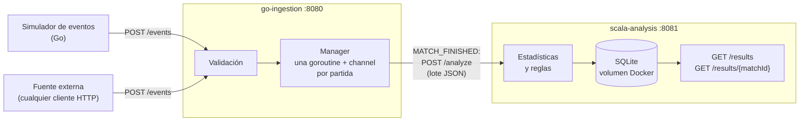
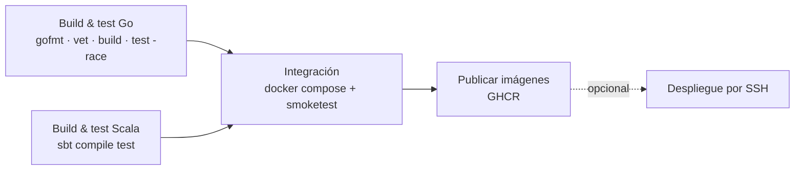

<div align="center">

# 🏁 GameStats

**Plataforma multilenguaje para procesar y analizar eventos de videojuegos**

Ingestión concurrente en **Go** · Análisis funcional en **Scala** · HTTP/JSON · SQLite · Docker · CI/CD

[](https://github.com/SeishiroGojo/gamestats/actions/workflows/ci.yml)


*Proyecto del curso de Lenguajes de Programación*

</div>

---

## Integrantes

| Integrante | GitHub |
|---|---|
| **Kendall Andrade** | [@kloadingS](https://github.com/kloadingS) |
| **Emerson Ramirez** | [@SeishiroGojo](https://github.com/SeishiroGojo) |

**Repositorio:** <https://github.com/SeishiroGojo/gamestats>

---

## Contenido

1. [Descripción](#descripción)
2. [Arquitectura](#arquitectura)
3. [Características](#características)
4. [Inicio rápido](#inicio-rápido)
5. [Ejemplo de resultado](#ejemplo-de-resultado)
6. [API](#api)
7. [Pruebas](#pruebas)
8. [CI/CD y despliegue](#cicd-y-despliegue)
9. [Extensibilidad y alcance](#extensibilidad-y-alcance)
10. [Estructura del repositorio](#estructura-del-repositorio)
11. [Documentación](#documentación)
12. [Cumplimiento del enunciado](#cumplimiento-del-enunciado)

---

## Descripción

GameStats recibe los eventos que genera una partida de videojuego, los valida, los agrupa por
partida y los convierte en estadísticas y detección de situaciones relevantes. La generación de
eventos está separada del análisis: un sistema externo (aquí, un simulador) produce los eventos y
GameStats solo necesita que respeten un formato común documentado.

El equipo eligió **carreras** como juego base. Se registran vueltas, cambios de posición,
penalizaciones, pit stops e incidentes, y a partir de ellos se calculan tiempos, clasificación y
**remontadas**. El diseño completo está en [`docs/game-design.md`](docs/game-design.md).

**División de responsabilidades**

| Módulo | Lenguaje | Paradigma | Qué hace |
|---|---|---|---|
| `go-ingestion` | Go | Imperativo y concurrente | Recibe eventos, los valida, mantiene el estado de cada partida activa y las procesa en paralelo |
| `scala-analysis` | Scala | Funcional | Calcula estadísticas y reglas con `filter`, `map`, `groupBy`, `foldLeft` y `collect`, y guarda y expone los resultados |

---

## Arquitectura



1. Cada evento se valida en Go (`eventId`, `timestamp`, `gameId`, `matchId`, `type` y `playerId` cuando corresponde). Los inválidos se rechazan con un detalle del motivo.
2. Cada partida activa vive en **su propia goroutine**, alimentada por un **channel**, por lo que varias partidas se procesan en paralelo sin bloquearse.
3. Al llegar `MATCH_FINISHED`, Go ordena los eventos por `timestamp` y envía el lote completo a Scala.
4. Scala calcula las estadísticas, aplica las reglas, **guarda el resultado en SQLite** y lo deja consultable.

La comunicación entre módulos es **HTTP/REST con JSON**; las decisiones y su justificación están en [`docs/architecture.md`](docs/architecture.md).

---

## Características

- **Ingestión y validación** de eventos con un formato común, documentado en [`docs/event-spec.md`](docs/event-spec.md).
- **Concurrencia real en Go:** una goroutine y un channel por partida, con acceso protegido por `sync.RWMutex`.
- **Estadísticas por jugador:** mejor vuelta, promedio, penalizaciones, pit stops, incidentes y posición final.
- **Estadísticas por partida:** vuelta más rápida y quién la hizo, y promedio general.
- **Estadísticas que combinan eventos:** clasificación final cruzada con vueltas, penalizaciones, pits e incidentes.
- **Regla de secuencia – remontada:** se detecta cuando un jugador gana 3 o más posiciones entre su peor momento y su posición final.
- **Persistencia** de resultados en SQLite sobre un volumen de Docker que sobrevive a reinicios.
- **Simulador y escenarios de prueba** para casos normales, remontada, desconexión y eventos inválidos.
- **Prueba de humo de punta a punta** automatizada, también dentro del pipeline.
- **CI/CD** con pruebas, integración con Docker Compose y publicación de imágenes en GHCR.

---

## Inicio rápido

**Requisitos:** [Docker Desktop](https://www.docker.com/products/docker-desktop/) y, para el simulador y la prueba de humo, [Go 1.22+](https://go.dev/dl/).

### 1. Levantar el sistema

```bash
docker compose up --build
```

| Servicio | URL |
|---|---|
| `go-ingestion` | http://localhost:8080 |
| `scala-analysis` | http://localhost:8081 |

### 2. Enviar eventos

**Con el simulador** (3 partidas en paralelo):

```bash
cd go-ingestion
INGESTION_URL=http://localhost:8080 go run ./cmd/simulator
```

**O con un escenario de ejemplo** (PowerShell):

```powershell
$body = Get-Content -Raw -Path data/scenario-comeback.json
Invoke-RestMethod -Uri http://localhost:8080/events -Method Post -ContentType "application/json" -Body $body
```

En bash: `curl -X POST http://localhost:8080/events -H "Content-Type: application/json" -d @data/scenario-comeback.json`

### 3. Consultar los resultados

```powershell
Invoke-RestMethod -Uri http://localhost:8081/results
Invoke-RestMethod -Uri http://localhost:8081/results/match-comeback | ConvertTo-Json -Depth 10
```

### 4. Verificar todo de punta a punta

```bash
cd go-ingestion
go run ./cmd/smoketest -data ../data
```

Debe terminar con `RESULTADO: todo correcto`. La guía completa está en [`docs/installation.md`](docs/installation.md).

---

## Ejemplo de resultado

Resultado real de `GET /results/match-comeback` (recortado). El piloto `p4` partió en la posición 4
y terminó primero, lo que activa la regla de remontada:

```json
{
  "matchStats": {
    "matchId": "match-comeback",
    "fastestLapMs": 89800,
    "fastestLapPlayer": "p4",
    "avgLapMsAllPlayers": 92075.0,
    "playerStats": [
      {
        "playerId": "p4",
        "bestLapMs": 89800,
        "avgLapMs": 91300.0,
        "totalPenaltyMs": 0,
        "penaltyCount": 0,
        "finalPosition": 1,
        "pitStopCount": 1,
        "totalPitMs": 2400,
        "incidentCount": 0
      }
    ]
  },
  "comebacks": [
    { "playerId": "p4", "worstPosition": 4, "finalPosition": 1, "positionsGained": 3 }
  ]
}
```

---

## API

| Módulo | Método y ruta | Descripción |
|---|---|---|
| Go `:8080` | `POST /events` | Recibe uno o varios eventos. `202` si todos son válidos, `207` si hay rechazados, `400` si el JSON es inválido |
| Go `:8080` | `GET /health` | Estado del servicio |
| Scala `:8081` | `POST /analyze` | Analiza el lote de una partida (lo usa Go) |
| Scala `:8081` | `GET /results` | Lista las partidas analizadas |
| Scala `:8081` | `GET /results/{matchId}` | Resultado completo de una partida (`404` si no existe) |
| Scala `:8081` | `GET /health` | Estado del servicio |

Referencia detallada con ejemplos: [`docs/api.md`](docs/api.md).

---

## Pruebas

| Nivel | Comando | Qué cubre |
|---|---|---|
| Go | `cd go-ingestion && go test -count=1 ./...` | Validación, manager concurrente, cliente HTTP, simulador y escenarios de `data/` |
| Go con detector de carreras | `go test -race -count=1 ./...` | Lo mismo, más condiciones de carrera (requiere `CGO_ENABLED=1`; el CI lo ejecuta siempre) |
| Scala | `cd scala-analysis && sbt test` | Estadísticas y regla de remontada con `munit` |
| Punta a punta | `cd go-ingestion && go run ./cmd/smoketest -data ../data` | Sistema completo levantado: validación, análisis, reglas, persistencia y consulta |

---

## CI/CD y despliegue

El pipeline ([`.github/workflows/ci.yml`](.github/workflows/ci.yml)) se ejecuta en cada `push`, `pull request` y etiqueta `v*`:



Las imágenes se publican en el registro de GitHub y se pueden ejecutar **sin compilar nada**:

```bash
docker compose -f docker-compose.deploy.yml pull
docker compose -f docker-compose.deploy.yml up -d
```

| Imagen | Registro |
|---|---|
| Ingestión (Go) | `ghcr.io/seishirogojo/gamestats-ingestion` |
| Análisis (Scala) | `ghcr.io/seishirogojo/gamestats-analysis` |

Detalles en [`docs/ci-cd.md`](docs/ci-cd.md) y [`docs/deployment.md`](docs/deployment.md).

---

## Extensibilidad y alcance

El diseño separa lo que es común a cualquier juego de lo que es propio de cada uno:

| Capa | ¿Depende del juego? |
|---|---|
| Sobre del evento (`eventId`, `timestamp`, `gameId`, `matchId`, `playerId`, `type`, `data`) | No |
| Validación de campos comunes, agrupación por partida, concurrencia, envío a Scala, persistencia y consulta | No |
| Tipos de evento y contenido de `data` | Sí |
| Estadísticas y reglas (Scala) | Sí |

Para incorporar otro juego (por ejemplo ajedrez o combate) se definen sus eventos, se agregan los
tipos que exigen `playerId` en la validación de Go y se escribe en Scala su propio análisis con las
mismas operaciones funcionales. No cambian la comunicación ni el almacenamiento. El paso a paso
está en [`docs/game-design.md`](docs/game-design.md), sección 4.

**Alcance actual:** el análisis implementado y demostrado es el de **carreras**. Las limitaciones
conocidas, como el análisis específico de un juego, los reintentos o los eventos tardíos, están
documentadas con honestidad en [`docs/architecture.md`](docs/architecture.md), sección 7.

---

## Estructura del repositorio

```
gamestats/
├── docs/                          # documentación del proyecto
├── data/                          # escenarios de prueba (válidos, remontada, desconexión, inválidos)
├── go-ingestion/                  # módulo Go
│   ├── cmd/server/                #   servidor de ingestión
│   ├── cmd/simulator/             #   fuente externa simulada de eventos
│   ├── cmd/smoketest/             #   prueba de humo de punta a punta
│   └── internal/{model,validate,match,client}
├── scala-analysis/                # módulo Scala
│   └── src/{main,test}/scala/gamestats/{model,analysis,Main.scala}
├── docker-compose.yml             # desarrollo: construye desde el código
├── docker-compose.deploy.yml      # despliegue: usa las imágenes de GHCR
└── .github/workflows/ci.yml       # pipeline CI/CD
```

---

## Documentación

| Documento | Contenido |
|---|---|
| [`docs/architecture.md`](docs/architecture.md) | Arquitectura, concurrencia, decisiones y comparación imperativo (Go) frente a funcional (Scala) |
| [`docs/game-design.md`](docs/game-design.md) | Juego elegido, justificación de los eventos y cómo extender a otros juegos |
| [`docs/event-spec.md`](docs/event-spec.md) | Especificación del formato de eventos y del intercambio Go → Scala |
| [`docs/statistics-and-rules.md`](docs/statistics-and-rules.md) | Estadísticas y regla de remontada, con escenarios de prueba |
| [`docs/api.md`](docs/api.md) | Referencia de los endpoints de ambos módulos |
| [`docs/installation.md`](docs/installation.md) | Instalación, ejecución y solución de problemas |
| [`docs/ci-cd.md`](docs/ci-cd.md) | Pipeline de CI/CD |
| [`docs/deployment.md`](docs/deployment.md) | Despliegue con las imágenes publicadas |
| [`docs/demo-guide.md`](docs/demo-guide.md) | Guion de la demostración |

---

## Cumplimiento del enunciado

| Requisito | Dónde se cumple |
|---|---|
| Go: ingestión, validación, flujo, estado por partida y concurrencia | `go-ingestion/` (una goroutine y un channel por partida) |
| Scala: colecciones funcionales, estadísticas y reglas | `scala-analysis/` (`Statistics`, `Rules`) y [`docs/statistics-and-rules.md`](docs/statistics-and-rules.md) |
| Estadística por jugador, por partida y combinando eventos | `playerStats` (vueltas, penalizaciones, pits, incidentes y clasificación final) y `matchStats` |
| Regla basada en una secuencia de eventos | Remontada (`Rules.detectComebacks`) |
| Resultados estructurados y consultables | JSON en SQLite; `GET /results` y `GET /results/{matchId}` |
| Fuente de eventos simulada | `cmd/simulator` y escenarios en `data/` |
| Formato de eventos documentado y justificación del diseño | [`docs/event-spec.md`](docs/event-spec.md) y [`docs/game-design.md`](docs/game-design.md) |
| Git, Docker, CI/CD y despliegue | Historial de commits, Dockerfiles, `docker-compose*.yml`, `ci.yml` y [`docs/deployment.md`](docs/deployment.md) |
| Instalación, ejecución y demostración | [`docs/installation.md`](docs/installation.md) y [`docs/demo-guide.md`](docs/demo-guide.md) |
| Imperativo frente a funcional | [`docs/architecture.md`](docs/architecture.md), sección 6 |

Las limitaciones conocidas y el trabajo futuro están en [`docs/architecture.md`](docs/architecture.md), sección 7.

---

<div align="center">

Hecho por **Kendall Andrade** y **Emerson Ramirez** · Curso de Lenguajes de Programación

</div>
